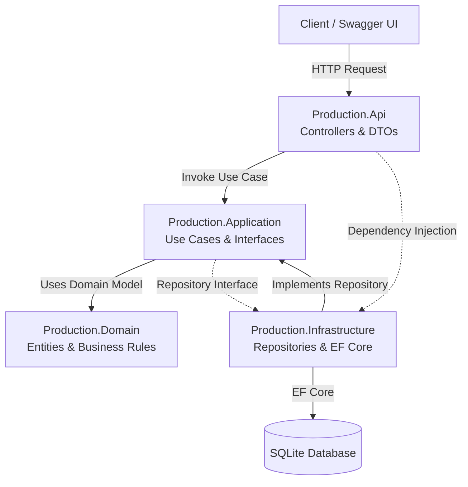
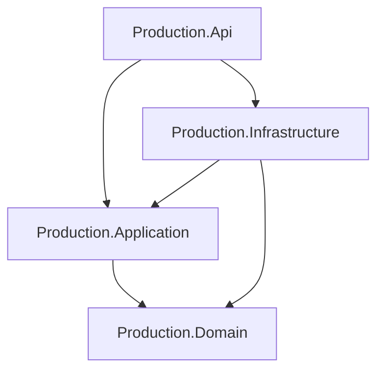
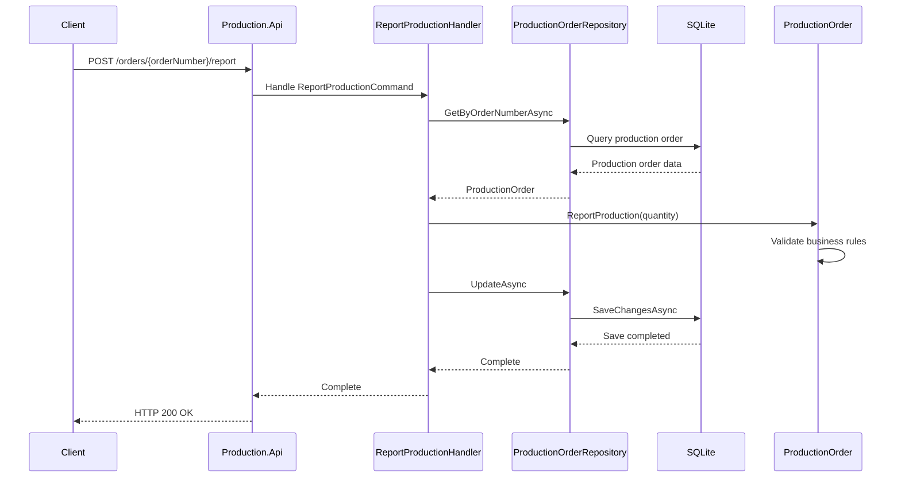

# System Architecture

## 1. Overview

Manufacturing Management System is built using Clean Architecture principles to separate business logic, application workflows, infrastructure implementations, and API presentation.

The architecture aims to provide:

- Separation of concerns.
- Maintainable and testable business logic.
- Independent infrastructure implementations.
- Clear dependency boundaries.
- A foundation for future service expansion.

## 2. High-Level Architecture

## 3. Project Layers

### 3.1 Production.Api

Responsible for exposing HTTP endpoints and handling client communication.

Responsibilities:

- REST API controllers.
- Request and response DTOs.
- HTTP status code handling.
- Dependency injection configuration.
- Swagger / OpenAPI documentation.

### 3.2 Production.Application

Contains application use cases and business workflow orchestration.

Responsibilities:

- Commands and queries.
- Application handlers.
- Repository interfaces.
- Coordination between domain entities and persistence abstractions.

Examples:

- CreateProductionOrderHandler
- GetProductionOrderHandler
- GetProductionOrdersHandler
- ReportProductionHandler

### 3.3 Production.Domain

Contains the core business model and domain rules.

Responsibilities:

- Production order entity.
- Production quantity validation.
- Production status transitions.
- Core business invariants.

The Domain layer does not depend on the API, Application, or Infrastructure layers.

### 3.4 Production.Infrastructure

Provides implementations for external technical concerns.

Responsibilities:

- Entity Framework Core DbContext.
- Repository implementations.
- Database configuration.
- EF Core migrations.
- SQLite persistence.

## 4. Dependency Direction

The project follows dependency inversion principles.

Dependency references:

| Project                   | References                  |
| ------------------------- | --------------------------- |
| Production.Api            | Application, Infrastructure |
| Production.Application    | Domain                      |
| Production.Infrastructure | Application, Domain         |
| Production.Domain         | None                        |

The Application layer defines repository contracts, while Infrastructure provides their concrete implementations.

## 5. Production Order Request Flow

Example: reporting production quantity.

## 6. Persistence

The current implementation uses:

- Entity Framework Core 10.
- SQLite database.
- Code-first entity configuration.
- EF Core migrations.

The `ProductionOrderRepository` implements `IProductionOrderRepository` and handles database operations.

## 7. Testing Strategy

The solution includes automated tests using xUnit.

Testing coverage includes:

| Test Area         | Purpose                                  |
| ----------------- | ---------------------------------------- |
| Domain Tests      | Validate production order business rules |
| Application Tests | Verify application use cases             |
| Repository Tests  | Verify database persistence and queries  |

SQLite In-Memory is used for repository integration tests.

## 8. Current Architecture Scope

The current implementation is a modular, layered backend application.

Future architectural improvements may include:

- Additional manufacturing services.
- API Gateway using Ocelot.
- Asynchronous messaging using RabbitMQ.
- Authentication and authorization.
- Structured logging and observability.
- Automated deployment pipelines.

These components are planned improvements and are not part of the current implementation.
